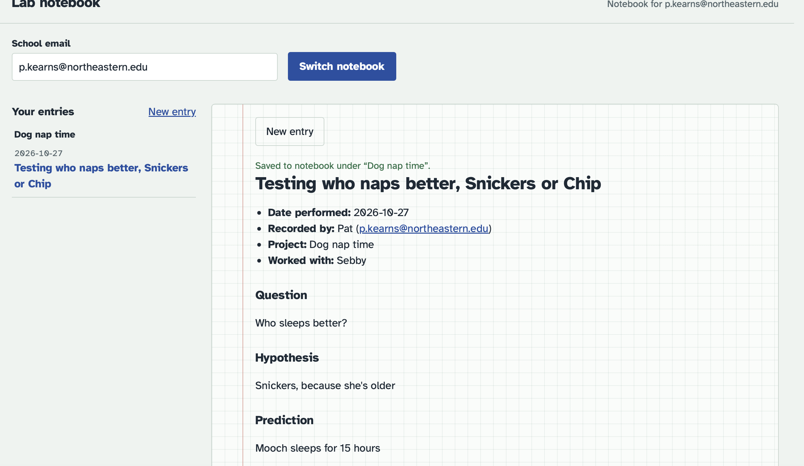

# Sleep Ericka

- **Date performed:** 2026-10-27
- **Recorded by:** Pat (p.kearns@northeastern.edu)
- **Project:** Dog nap time
- **Worked with:** Ericka

## Question

Sleep?

## Hypothesis

Ericka can sleep for 24 hours cause she not a healthy woman

## Prediction

Yes

## Materials and reagents

bed, bed pan, lunch meats

## Procedure

Sleep, she know what do

## Deviations from the protocol

No

## Observations and results

She sleep

### Data files

