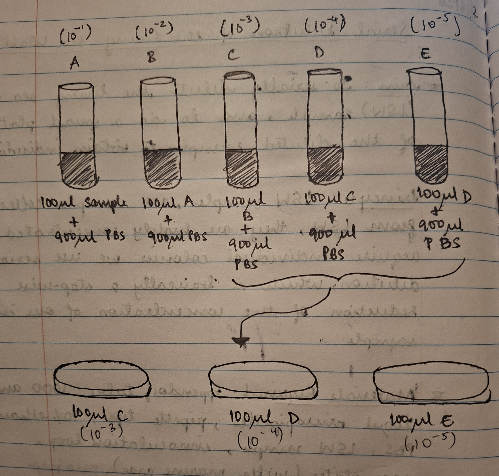
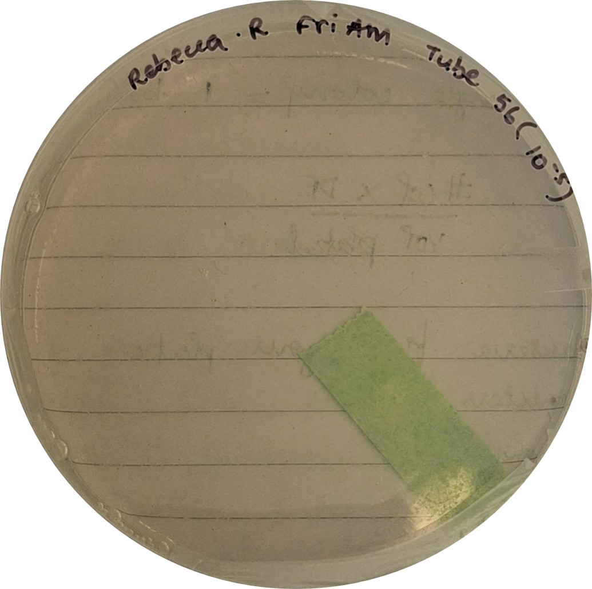
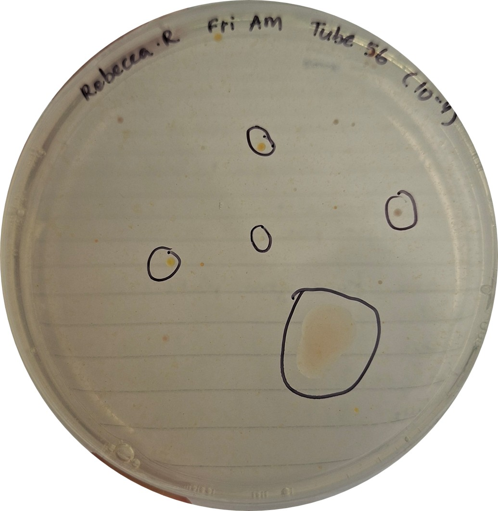
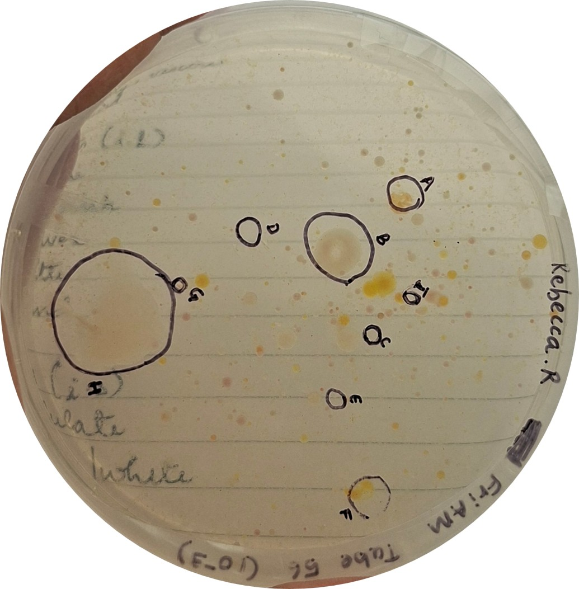

# Serial Dilution of the Living Sea Wall Sample

- **Date performed:** 2026-09-18
- **Recorded by:** Rebecca Reji (reji.re@northeastern.edu)
- **Project:** Living Sea Wall

## Question

Aim: To serially dilute the living sea wall (LSW) sample, and to perform a spread plate of the diluted sampl to obtain individual colonies

## Hypothesis

LSW samples are collected from the Living Sea Wall; they are highly concentrated. To acquire individual colonies, we use serial dilutions, which are basically a stepwise reduction in the concentration of our initial sample.

## Materials and reagents

- Eppendorf tubes
- 1000 and 200 µL micropipettes
- Pipette tips
- 70% Ethanol
- Phosphate-buffered saline (PBS)
- LSW sample (sample tube: 56)
- Disposable inoculation loop
- Marine agar plates
- Parafilm

## Procedure

- Wipe down BSC using 70% ethanol
- Label 5 Eppendorf tubes: (10^-1), (10^-2), (10^-3), (10^-4) and (10^-5)
- Add 900 µL PBS to all tubes
- Serially dilute the sample by mixing 100 µL of sample into tube (10^-1) and perform subsequent dilutions
- Change pipette tip between each dilution
- Take 100 µL from the last three tubes [(10^-3), (10^-4) and (10^-5)] and inoculate on the agar plate using an inoculation loop
- Parafilm the plate
- Incubate at 37°C

## Deviations from the protocol

_None recorded._

## Observations and results

(09/25/26)
- (10^-5) plate: No colonies were observed on the plate
- (10^-4) plate: 10-11 colonies of different morphologies were observed 
- (10^-3) plate: Multiple colonies were observed

### Data files

## Interpretation

- For every colony, we assume that one bacterium was present in our original sample
- We can use the following formula to get the number of bacteria in our initial tube
                              (No. of Colonies x Dilution Factor)/ Volume Plated

## Next steps

- Grow individual, unique colonies in liquid media so they can be further plated
- Overlapping colonies need to be streaked out to obtain individual colonies
