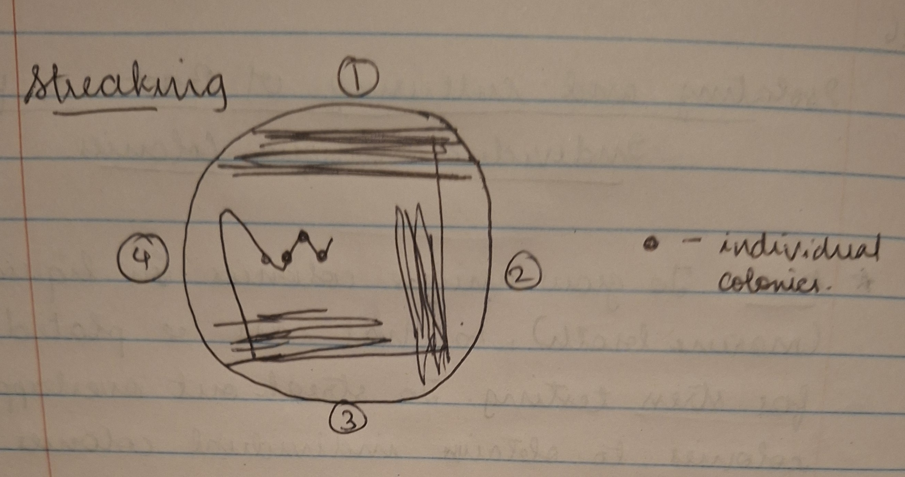
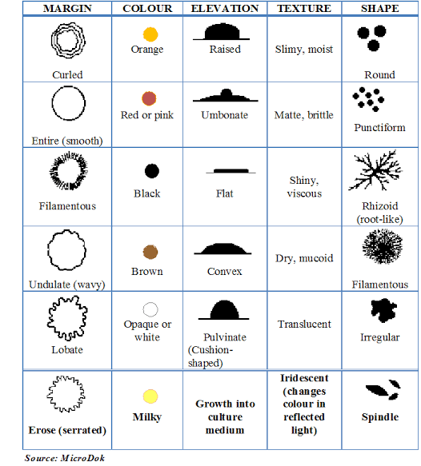
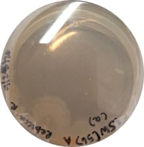
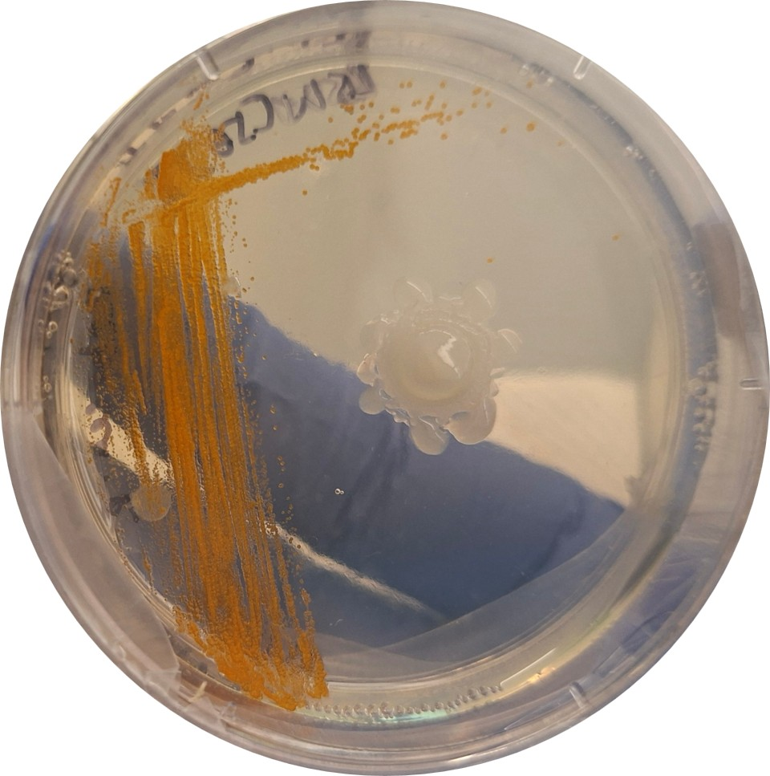
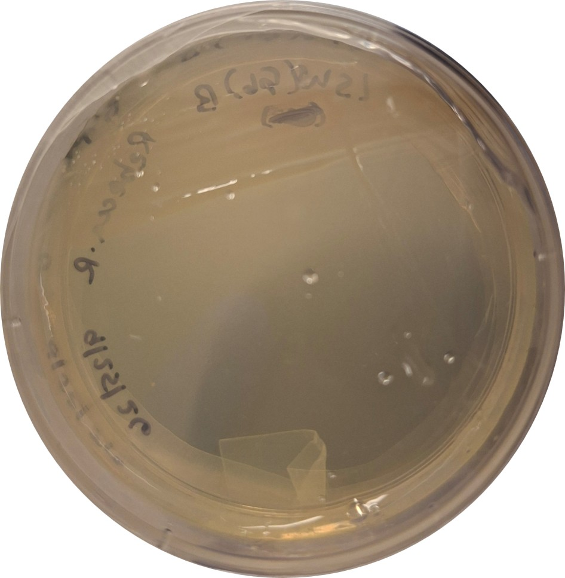
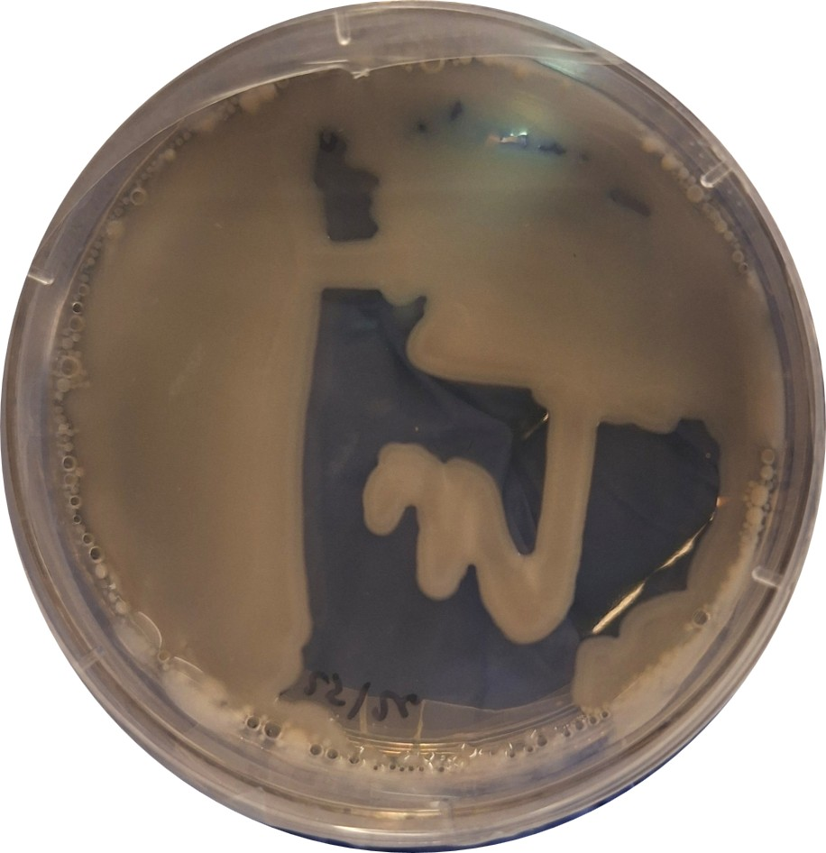

# Isolating and Culturing of Bacteria from Individual Unique Colonies

- **Date performed:** 2026-09-25
- **Recorded by:** Rebecca Reji (reji.re@northeastern.edu)
- **Project:** Living Sea Wall

## Question

Aim: To grow unique colonies in liquid media so that they can be plated later for stress testing. To streak out overlapping colonies to obtain individual colonies

## Hypothesis

The quickest way to obtain a large number of bacteria from a colony is to culture them in a liquid medium. Obtaining/ deciding on unique colonies is subjective and can be done through colony morphology.

## Materials and reagents

- Agar plates with LSW colonies
- Culture tubes
- 1000 uL micropipettes
- Marine broth
- Marine agar plates
- Inoculation loop
- Parafilm

## Procedure

- Observe colonies; mark unique colonies for isolation. Unique colonies can be identified using colony morphology (border, colour, elevation, texture and shape)
- Check if it's an individual colony or if it's overlapping borders with another colony
- If individual: inoculate it into 1 mL of marine broth in a culture tube
- If overlapping: streak on an agar plate to obtain individual colonies (swab from the border where both colonies are meeting)
- Place the liquid culture in a shaking incubator at 37°C
- Place the plates after parafilming into an incubator at 37°C

## Deviations from the protocol

_None recorded._

## Observations and results

Used plate (10^-3)
(09/25/2026)
- LSW [56]A: undulated, orange, growth into culture medium, dry-mucoid, punctiform -> streak
- LSW [56]B: entire, opaque/white, convex, shiny, viscous, round -> streak
- LSW [56]C: entire, yellow, convex, slimy, viscous, round -> liquid
- LSW [56]D: entire, pink, convex, translucent, round -> liquid
- LSW [56]E: entire, opaque/white, convex, matte, round -> liquid
- LSW [56]F: entire, yellow, convex, shiny, viscous, round -> liquid
- LSW [56]G: entire, pink, convex, matte, round -> liquid
- LSW [56]H: undulated, opaque/white, raised, slimy, moist, irregular -> streak
- LSW [56]I: entire, red/pink, convex, shiny, round -> streak

(10/02/26)
- All liquid cultures were discarded because of contamination
- LSW [56]A(a): two types of colonies were present, but they weren't separated from each other
- LSW [56]A(b): a type of colony was observed, similar to the one (orange) observed in the plate LSW [56]A(a) 
- LSW [56]B: one type of bacteria was observed; there were no individual colonies
- LSW [56]H: one type of bacteria was observed; there were no visible individual colonies

### Data files

## Interpretation

- There could be multiple sources of contamination in our liquid cultures: media (autoclave wouldn't have eradicated the spores/toxins), plates and tubes weren't sterile, contamination during serial dilution (inoculation loop, pipette tips), and contact contamination
- Some plates not having distinct colonies: sample taken during inoculation could have been in more or way too little volume
