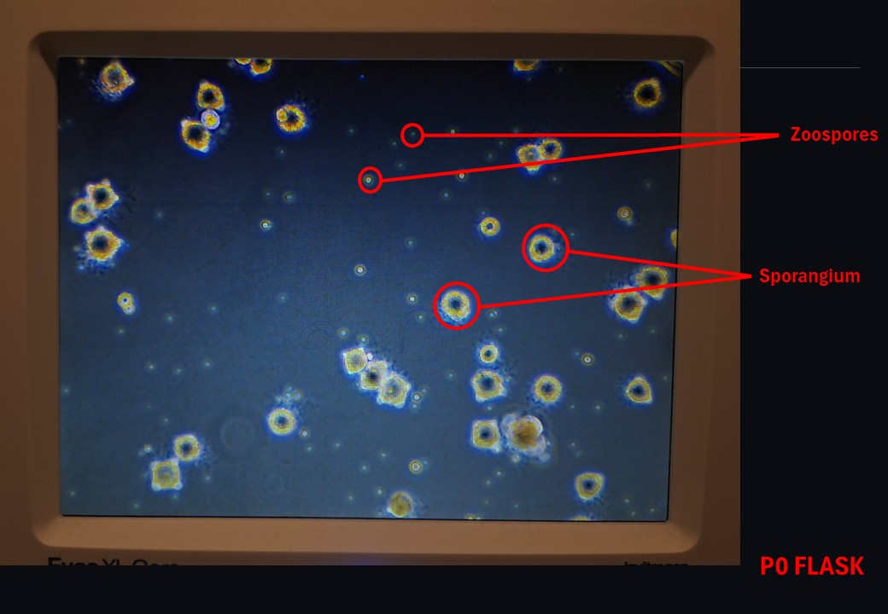
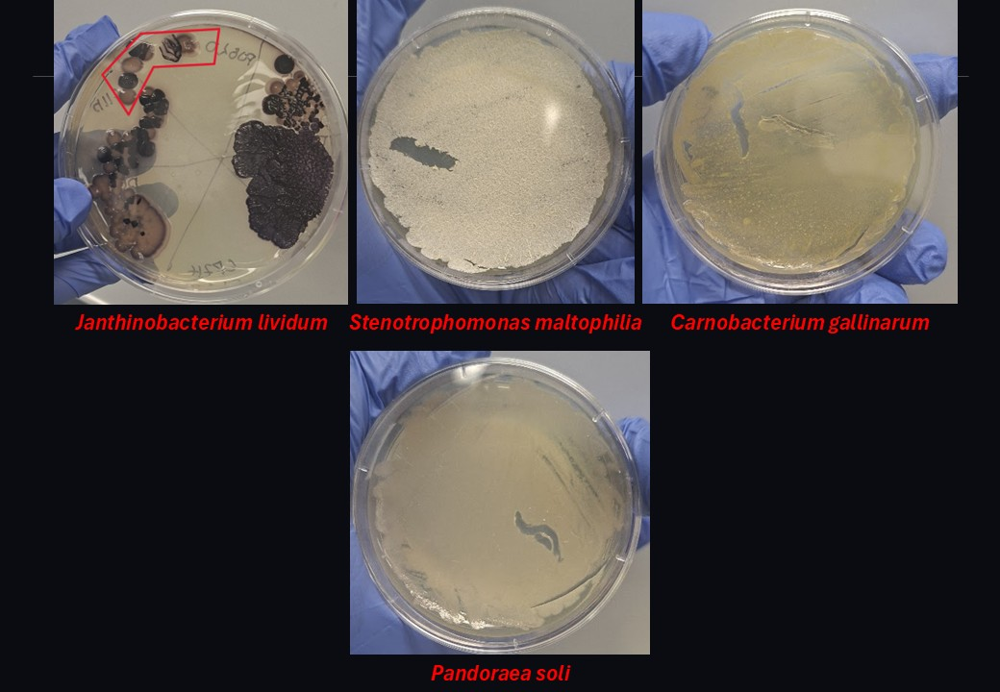
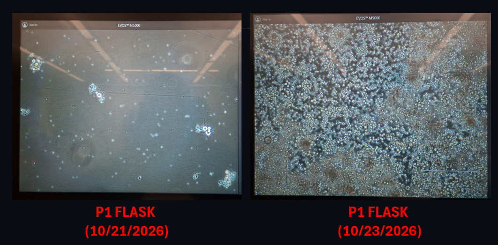

# Reviving Batrachochytrium dendrobatidis (Bd) and Bacterial Isolates From Frog Skin

- **Date performed:** 2026-10-16
- **Recorded by:** Rebecca Reji (reji.re@northeastern.edu)
- **Project:** Establishing a Co-culture System Between the Frog Microbiome and Batrachochytrium dendrobatidis (Bd)

## Hypothesis

Aim: To passage revived Bd and to revive bacterial isolates from -80°C onto an LB agar plate

## Materials and reagents

- LB agar plates
- T25 flask
- Inoculation loop
- Micropipette
- Pipette tips
- Cell scraper
- Bd culture (P0 passage on 10/12/26): Jel 197 strain
- Bacterial stocks from -80°C: 
  + Carnobacterium gallinarum (gram-positive): RIB628
  + Pandoraea soli (gram-negative): RIB646B
  + Stenotrophomonas maltophilia (gram-negative): RIB636B
  + Janthinobacterium lividum (gram-negative): PO820
- 1% tryptone

## Procedure

INOCULATING Bd
- In a T25 flask, add 9 mL of 1% tryptone medium
- Label the flask (Bd, strain, P1, RR, Date)
- Using a cell scraper, detach all moieties from the surface of the P0 flask
- Take 1 mL and put it into the new, labelled T25 flask containing fresh medium
- Incubate at 20°C

INOCULATING BACTERIAL ISOLATES
- Pipette 10-100 uL of bacterial stock from the cryovial into the LB agar plate and, using an inoculation loop, spread it across the surface
- Incubate at RT

## Deviations from the protocol

_None recorded._

## Observations and results

(10/16/26)
- P0 flask was slightly confluent
- Zoospores, sporangium with zoospores and empty sporangium were observed

(10/23/26)
- P1 flask was over-confluent and ready to passage
- All bacterial isolates inoculated had grown as a lawn

### Data files

