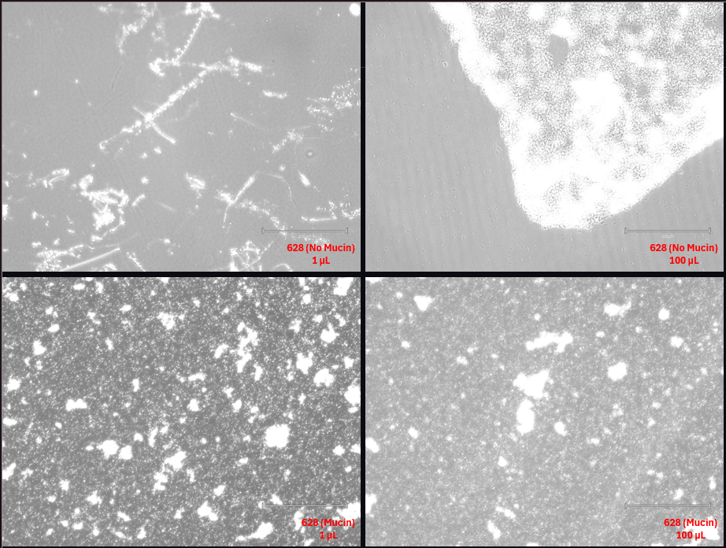
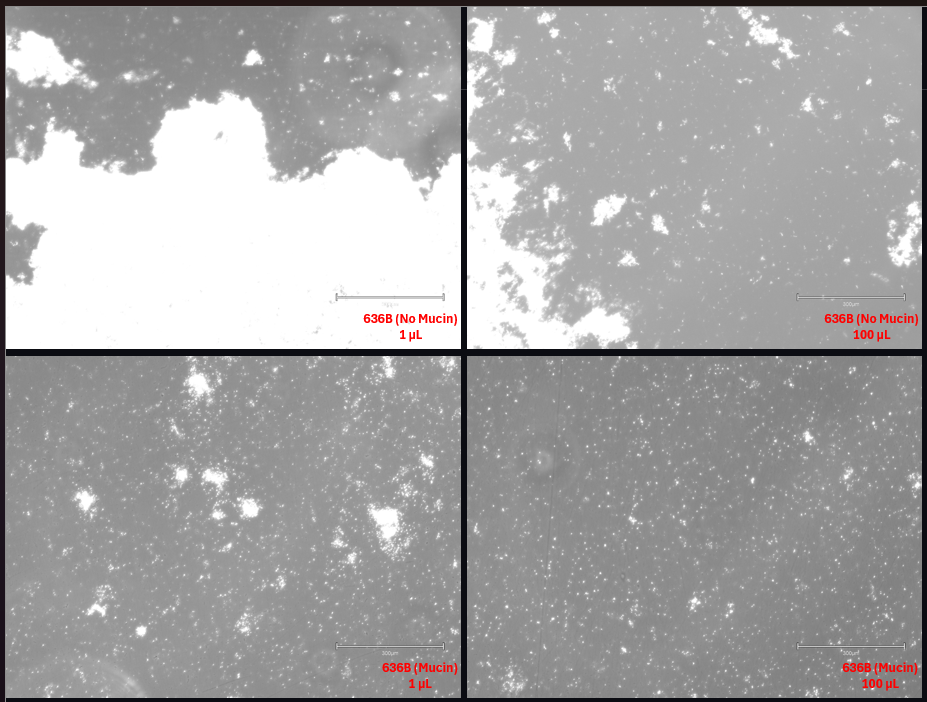
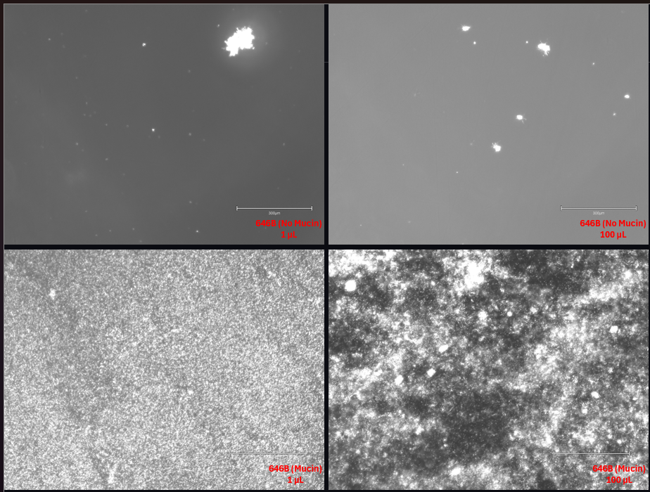
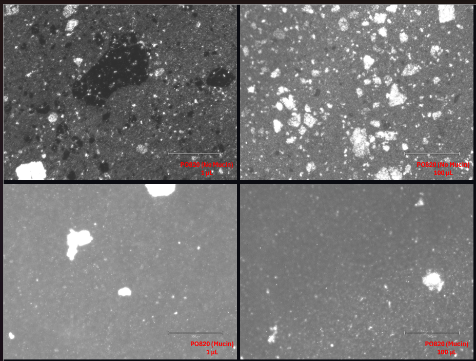

# Primary Bd-Bacteria Co-culture

- **Date performed:** 2026-10-23
- **Recorded by:** Rebecca Reji (reji.re@northeastern.edu)
- **Project:** Establishing a Co-culture System Between the Frog Microbiome and Batrachochytrium dendrobatidis (Bd)

## Hypothesis

Aim: To set up a pilot co-culture of Bd and bacterial isolates to determine the seeding volume of bacteria and Bd

## Materials and reagents

- Bacterial agar plates from the previous week
- P1 Bd from the previous week
- T25 Flask
- Minimal Media with Mucin
- Minimal Media w/o Mucin
- Serological pipettes
- Electronic Pipette Aid
- Micropipette
- Pipette Tips
- Cell Scraper
- Eppendorf Tube
- DPBS
- Inoculation Loop

## Procedure

PREPARING BACTERIAL LIQUID STOCK
- Label 4 Eppendorf tubes (628/ 636B/ 646B/ PO820)
- Add 1 mL PBS to each tube
- Using an inoculation loop, collect cells from the agar plate and mix them into the PBS
- Vortex each tube until it's completely homogenized

CO-CULTURE
- Label the T25 Flasks 
  + Jel 197
  + Bacterial isolate (628/ 636B/ 646B/ PO820)
  + Volume of bacterial stock used (1uL/ 5uL/ 10uL/ 50uL/ 100uL)
  + Mucin or No Mucin (M/ NM)
  + Initials (RR)
  + Date (10/23/2026)
- Add 9.5 mL of media in respective flasks (with or without mucin)
- Add 500 uL Bd to each flask
- Add different volumes of bacteria from the prepared stock into the respective flasks (1uL/ 5uL/ 10uL/ 50uL/ 100uL)
- Swirl gently to mix
- Incubate at 20°C

## Deviations from the protocol

For 628 Bacterial Isolate
- The initial plan was to perform the inoculation in T75 flasks; however, the setup was later changed to T25 flasks.
- For the 628 bacterial isolate conditions, T75 flasks were used and the volumes were doubled:
  + Culture Media: 19 mL
  + Bd: 1 mL
  + Bacterial Isolate Stock (2uL/ 10uL/ 20uL/ 100uL/ 200uL)

## Observations and results

11/30/2026 
The media were aspirated and discarded from the flask.
In all flasks, there was a dense population of bacteria; no Bd sporangia were observed

### Data files

## Interpretation

We assume that the bacteria outgrew Bd and inhibited its growth or killed it

## Next steps

Establish a Bd culture first, then add bacteria. This will test whether the bacteria can inhibit an established Bd culture, rather than only preventing Bd from establishing when co-inoculated.
