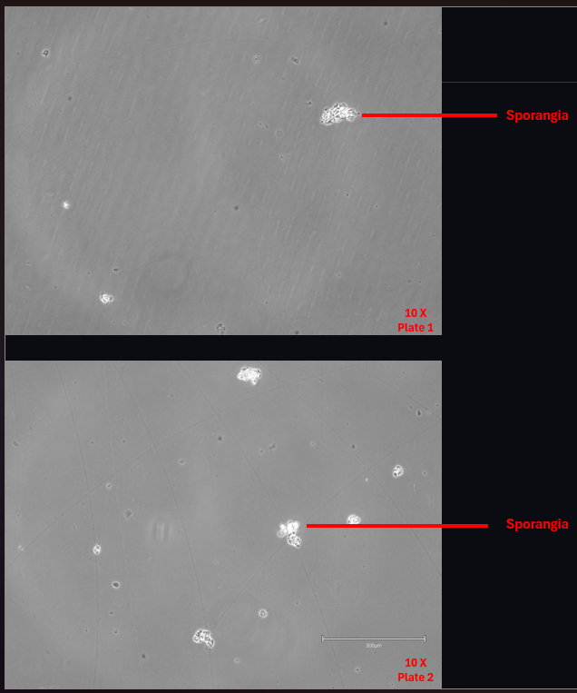

# Co-culture: Establishing Bd

- **Date performed:** 2026-10-30
- **Recorded by:** Rebecca Reji (reji.re@northeastern.edu)
- **Project:** Establishing a Co-culture System Between the Frog Microbiome and Batrachochytrium dendrobatidis (Bd)

## Hypothesis

Aim: To establish a Bd culture for a co-culture experiment testing

## Materials and reagents

- Six-well culture plates
- 1% Tryptone Broth
- Serological Pipette (2 mL)
- Micropipette
- Pipette tips
- Bd culture: P3

## Procedure

- Label the cell culture plates
- Add 2 mL of 1% Tryptone broth to 5 wells (because we are trying five different volumes of bacterial isolates for the next step)
- Add 200 uL of Bd to each well and mix
- Place in the incubator at 20°C

## Deviations from the protocol

_None recorded._

## Observations and results

06/11/2026
Few sporangia and zoospores were visible. Most sporangia appeared unattached and free-floating rather than adhered to the flask surface.

### Data files

## Interpretation

Possible poor growth or low viability of the inoculum

## Next steps

Start a fresh P1 of Bd from a cryostock, as the low sporangia count and poor attachment suggest the previous inoculum may have been non-viable. Repeat the protocol
