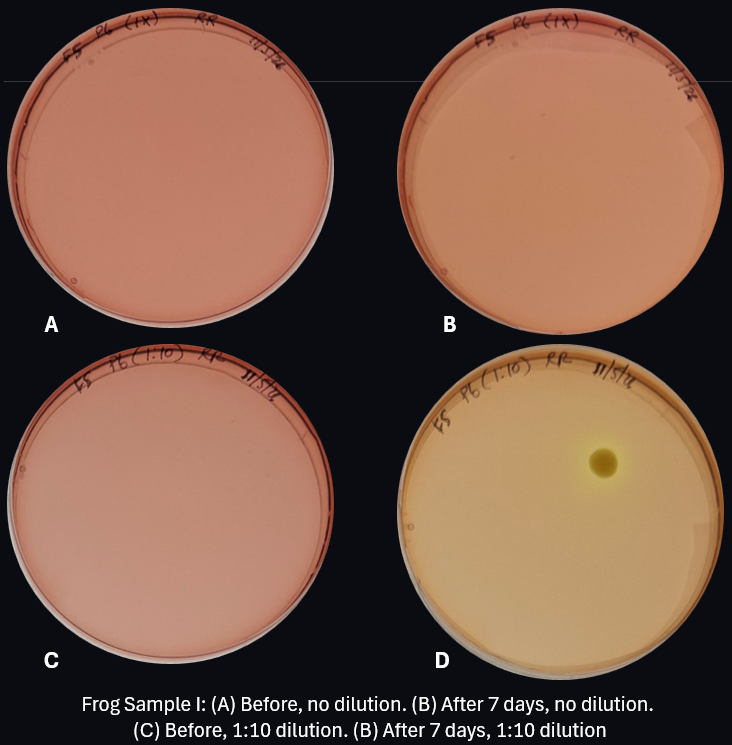
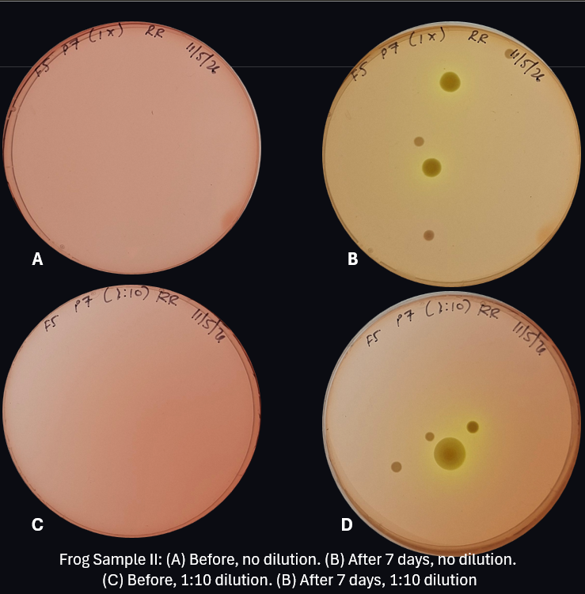
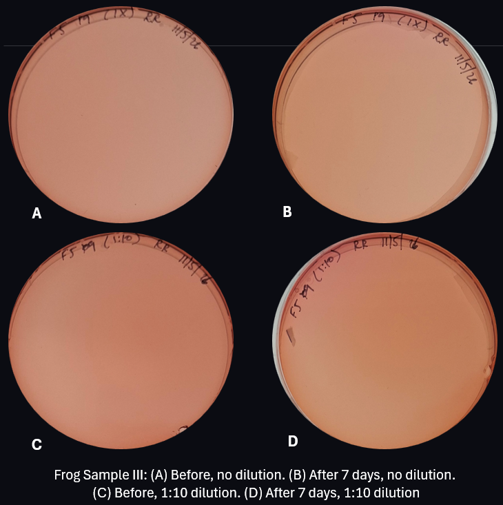
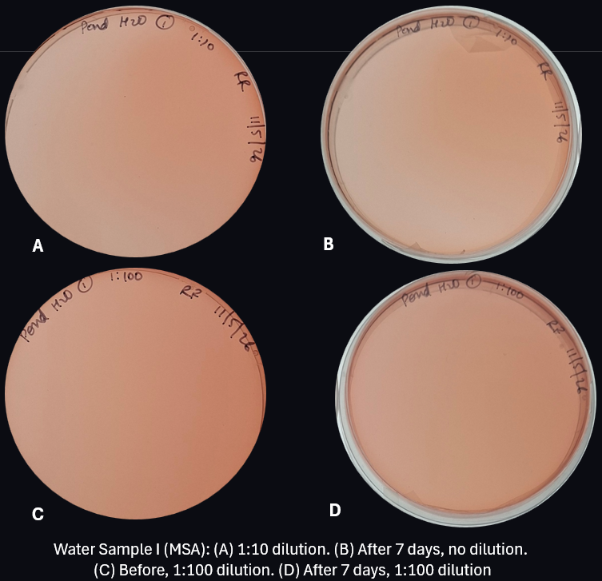
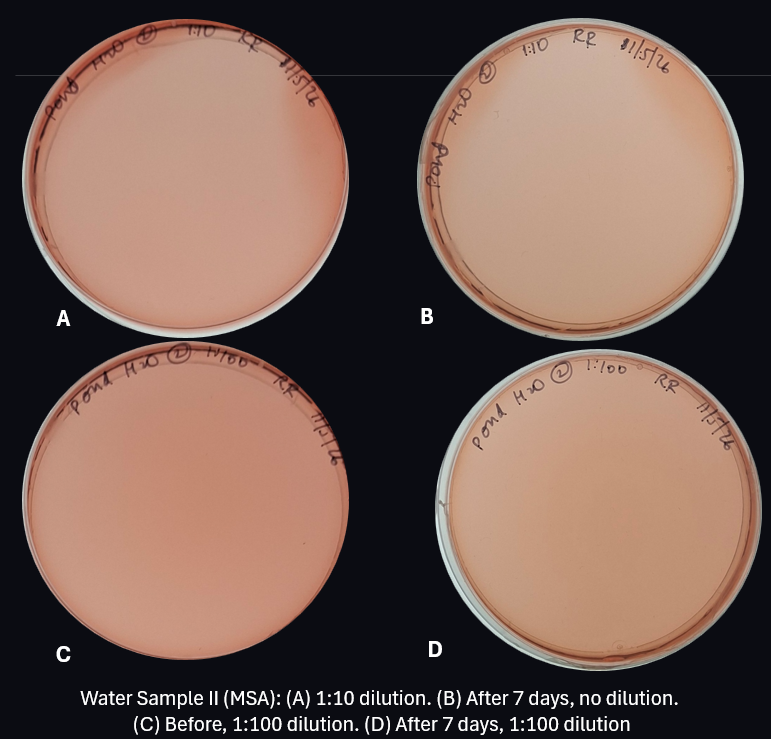
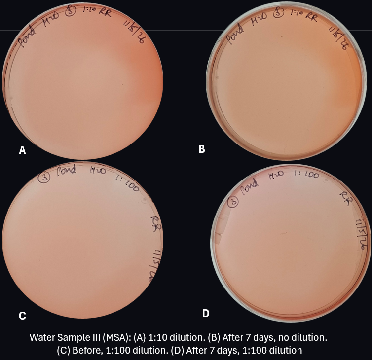
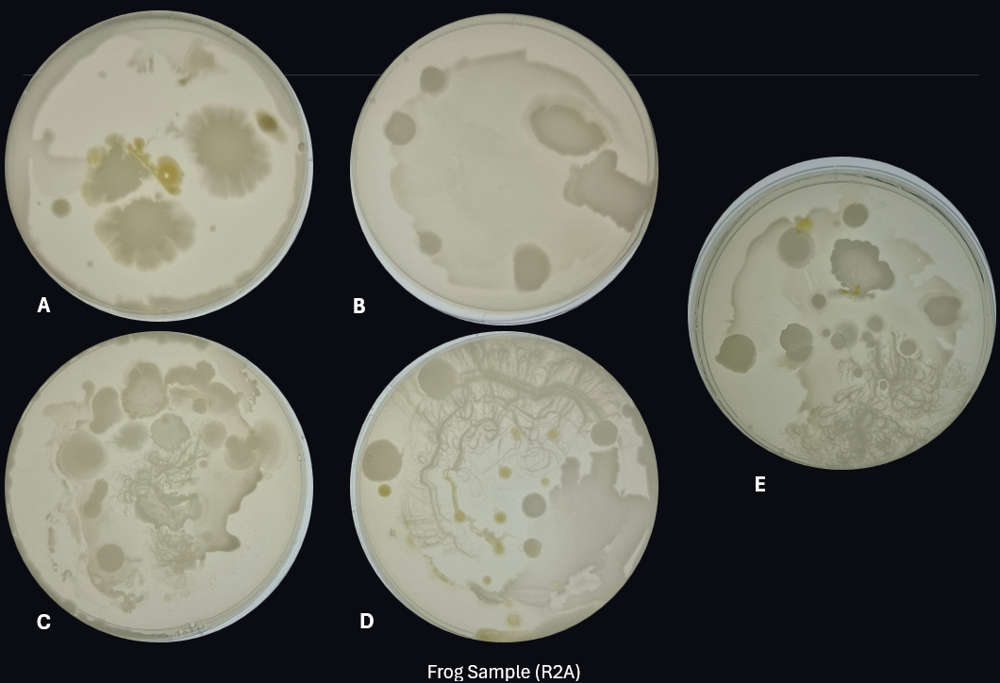
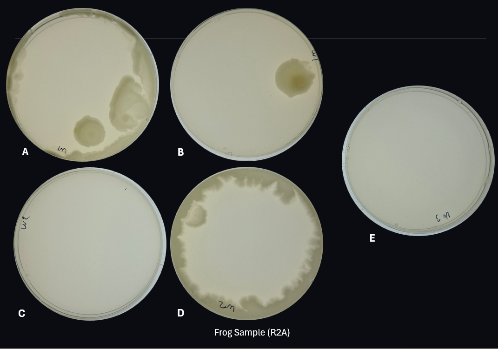

# Reviving Bacteria from Cryo Stock

- **Date performed:** 2026-11-06
- **Recorded by:** Rebecca Reji (reji.re@northeastern.edu)
- **Project:** Host vs. Habitat: Comparing Bacterial Isolates from Frogs and Water

## Hypothesis

To revive bacteria from cryopreserved frog skin swab and pond water samples by culturing on Mannitol Salt Agar (MSA).

## Materials and reagents

- Mannitol Salt Agar (MSA)
- Petri Plates
- R2A Agar
- Inoculation loop
- Micropipette
- Pipette tips
- Eppendorf tubes
- Frog skin swab
- Water sample from pond

## Procedure

POURING PLATES
- Pour ~20 mL MSA into petri dishes
- Let it dry completely

INOCULATING SAMPLES (FROG SKIN BACTERIA)
- Direct plating
  + Pipette 20 µL of the cryostock sample onto an MSA plate.
  + Using a sterile inoculating loop, spread the sample across the agar surface.
  + Incubate the plate at 20C.
- 1:10 dilution and plating
  + Add 900 µL of PBS to an Eppendorf tube.
  + Add 100 µL of the cryostock sample to the PBS, giving a 1:10 dilution (10⁻¹).
  + Mix thoroughly by pipetting up and down.
  + Plate 100 µL of the diluted sample onto an MSA plate and spread evenly across the agar surface.
  + Incubate at 20C.

INOCULATING SAMPLES (POND WATER)
- 1:10 dilution and plating
  + Add 900 µL of PBS to an Eppendorf tube.
  + Add 100 µL of the cryostock sample to the PBS, giving a 1:10 dilution (10^-1).
  + Mix thoroughly by pipetting up and down.
  + Plate 100 µL of the diluted sample onto an MSA plate and spread evenly across the agar surface.
  + Incubate at 20C.
- 1:100 dilution and plating
  + Add 900 µL of PBS to two Eppendorf tubes (10^-1, 10^-2).
  + Add 100 µL of the cryostock sample to the PBS in tube 1, giving a 1:10 dilution).
  + Mix thoroughly by pipetting up and down.
  + Add 100 µL sample from tube 1 to tube 2, giving a 1:100 dilution
  + Plate 100 µL of both diluted samples onto different MSA plates and spread evenly across the agar surface.
  + Incubate at 20C.

## Deviations from the protocol

- After four days of incubation, most of the plates showed no growth. Therefore, the same samples were replated on R2A agar plates.

## Observations and results

- A few isolated colonies were observed on the MSA plates.
- Both isolated and overlapping colonies were observed on the R2A agar plates.
- No growth was observed in most pond water samples on both media.

### Data files

## Interpretation

- The low number of colonies on the MSA plates may be because most bacteria in the pond water were Gram-negative and therefore inhibited by this selective medium, or it might be because the inoculation volume was low

## Next steps

- Isolate unique colonies
- Replate water samples at a higher concentration
